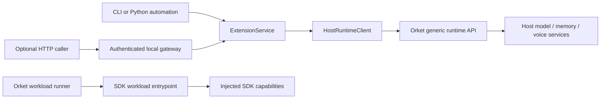

# Communication and authority

## Headless first

Companion calls its extension-owned HTTP layer a BFF because its caller is a browser.
For this template the reusable component is an application service plus a host adapter.
The CLI and Python automation call that service directly. The optional HTTP adapter is
only another transport into the same service; it does not contain product orchestration.



The extension owns product schemas, prompts, workflow choices and response projection.
Orket owns runtime capabilities, provider access, memory persistence, and host authority.
Do not embed provider SDKs or import `orket.*` to cross this boundary.

## External process contract

`HostRuntimeClient` sends `X-API-Key` from server-side configuration. Every operation is
under `/v1/extensions/{extension_id}/runtime/`:

| Method | Suffix | Adapter method |
| --- | --- | --- |
| GET | `status` | `status` |
| GET | `models` | `models` |
| POST | `llm/generate` | `generate` |
| POST | `memory/query` | `memory_query` |
| POST | `memory/write` | `memory_write` |
| POST | `memory/clear` | `memory_clear` |
| GET | `voice/state` | `voice_state` |
| POST | `voice/control` | `voice_control` |
| POST | `voice/transcribe` | `transcribe` |
| GET | `tts/voices` | `voices` |
| POST | `tts/synthesize` | `synthesize` |

The adapter reuses one async connection pool within its context manager and closes it on exit,
including cancellation. Redirects and environment proxy configuration are disabled to keep
credentials at the configured host. Use HTTPS for a remote host. No operation retries
automatically; a timeout can mean an operation ran but its response was lost.

HTTP errors, connection errors, invalid JSON and unsuccessful envelopes produce stable
`ExtensionError` codes. Raw upstream error bodies are never returned. CLI failures exit
nonzero; the HTTP adapter maps these errors to non-2xx responses. Product generation rejects
empty output. The adapter relays host model selection; it does not implement fallback itself.

## Python automation

```python
import asyncio
from extension_template.domain import GenerateInput
from extension_template.host_runtime import HostRuntimeClient
from extension_template.service import ExtensionService
from extension_template.settings import load_settings

async def main():
    async with HostRuntimeClient(load_settings()) as host:
        result = await ExtensionService(host).generate(GenerateInput(message="Hello"))
        print(result["text"])

asyncio.run(main())
```

For a persisted product value, use the same client in your service:

```python
await host.memory_write(
    scope="session_memory", session_id="job-123",
    key="result", value=result["text"], metadata={"kind": "example_result"},
)
saved = await host.memory_query(scope="session_memory", session_id="job-123", query="", limit=10)
await host.memory_clear(scope="session_memory", session_id="job-123")
```

The host namespaces memory by extension ID and session. Give every clone a unique extension ID
to avoid shared state. Reuse a session deliberately; do not treat the session ID as authentication.
The memory client also supports `profile_memory` and `episodic_memory`, subject to host policy.
Clearing profile memory is not part of this contract. Model generation and memory writes are
separate operations, so define partial-failure and concurrency behavior before building a
multi-step workflow. This template does not claim transactionality or exactly-once execution.

Voice methods are plumbing for extensions that need them; no recorder or playback system is
included. Consult host status before using optional capabilities. Supply base64 audio to
`transcribe`; synthesized audio is returned in the host response for the caller to handle.

## Host-dispatched SDK workload

The manifest points to `extension_template.workload:run`. Orket supplies a `WorkloadContext`.
The workload uses `ctx.capabilities.llm()` and returns `WorkloadResult`. It shares product
input/prompt rules with the external service but uses the SDK transport supplied by the host.
Model/provider selection belongs to host configuration in this mode; payload overrides are
rejected rather than silently ignored. Add only capabilities the workload actually uses to
`required_capabilities`.

The generic runtime API is a capability surface, not a workload dispatcher. The starter's
external CLI demonstrates the former; the manifest provides the latter. Neither manifest
validation nor choosing an extension ID constitutes runtime permission or registration.
